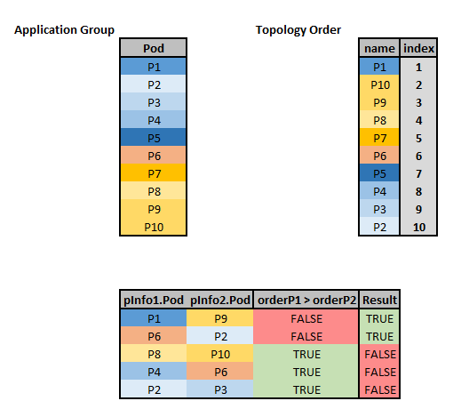

## TopologicalSort Plugin

#### Extension point: QueueSort 

Pods belonging to an AppGroup should be sorted based on their topology information. 
The `TopologicalSort` plugin compares the pods' index available in the AppGroup CRD for the preferred sorting algorithm. 

If pods do not belong to an AppGroup or belong to different AppGroups, we follow the 
strategy of the **less function** provided by the [QoS plugin](https://github.com/kubernetes-sigs/scheduler-plugins/tree/master/pkg/qos).

```go
// Less is the function used by the activeQ heap algorithm to sort pods.
// Sort Pods based on their App Group and corresponding service topology.
// Otherwise, follow the strategy of the QueueSort Plugin
func (ts *TopologicalSort) Less(pInfo1, pInfo2 *framework.QueuedPodInfo) bool {
    // 1) Check if both pods belong to an AppGroup
    (...)
    // 2) If one of them does not belong -> Return: Follow the Less function of the QoS Sort plugin. 
    (...)
    // 3) Check if both pods belong to the same AppGroup
    (...)
    // 4) If Pods belong to the same App Group -> Get AppGroup from AppGroup lister
    (...)
        // 4.1) Binary search to find both order indexes since topology list is ordered by Workload Name
        (...)
        // 4.2) Return: a lower index is better, thus invert result!
        return !(order(pInfo1) > order(pInfo2))
    // 5) Pods do not belong to the same App Group: return and follow the strategy from the QoS plugin
    (...)
}
```

#### `TopologicalSort` Example

Let's consider the Online Boutique application shown previously. 
The AppGroup consists of 11 workloads (11 groups of pods) and the topology order based on the KahnSort algorithm is **P1, P10, P9, P8, P7, P6, P5, P4, P3, P2, P11.**

The plugin favors low indexes. Thus, depending on the two pods evaluated in the Less function, the result (bool) is the following: 

<p align="center"></p>

For instance, consider the following scheduler config as an example to enable the `TopologicalSort` plugin:

```yaml
apiVersion: kubescheduler.config.k8s.io/v1
kind: KubeSchedulerConfiguration
leaderElection:
  leaderElect: false
clientConnection:
  kubeconfig: "REPLACE_ME_WITH_KUBE_CONFIG_PATH"
profiles:
- schedulerName: network-aware-scheduler
  plugins:
    queueSort:
      enabled:
      - name: TopologicalSort
      disabled:
      - name: "*"
  pluginConfig:
  - name: TopologicalSort
    args:
      namespaces:
      - "default"
```

## Performance

Benchmarks run with `go test -bench='^BenchmarkTopologicalSort_' -benchmem -benchtime=2s` (`bench_test.go`) on an
Apple M5 Pro (`GOMAXPROCS=15`), with a controller-runtime fake client. Pod-queue sizes tested: 10, 100, 500, 1,000.

AppGroup: onlineboutique (11 workloads). Each benchmark iteration runs N parallel `Less()` comparisons using
`workqueue.ParallelizeUntil` (parallelism=16).

### Less (QueueSort)

`Less()` performs two binary searches through the AppGroup's topology order list (size 11), one per pod info.
Single-call complexity: **O(log k)**, where k is the number of workloads.

The benchmark measures **N parallel `Less()` calls** (total work scales with N).

| Pods (queue depth) | ns/op | B/op | allocs/op |
|---:|---:|---:|---:|
| 10 | 595,761 | 376,144 | 3,154 |
| 100 | 5,695,018 | 3,747,028 | 31,398 |
| 500 | 28,278,671 | 18,696,465 | 156,896 |
| 1,000 | 55,710,961 | 37,324,364 | 313,716 |

Cost scales linearly with queue depth, about 56 µs per `Less()` call. Each call also fetches the AppGroup through
the client; in the benchmark, the fake client deep-copies the CR on every `Get`. In a running scheduler the plugin
reads the AppGroup from the informer cache of `util.NewClientWithCachedReader`.
